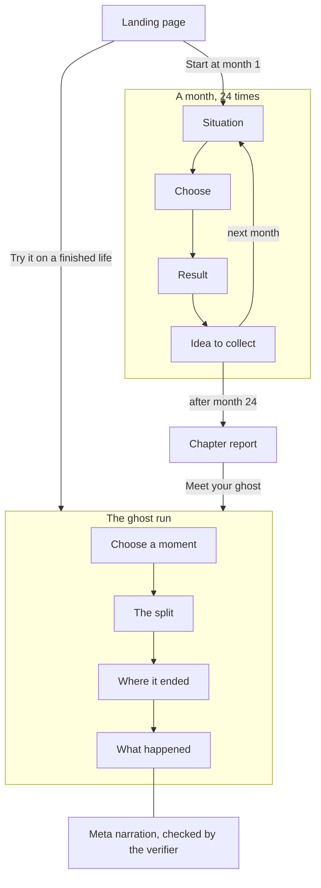

# Ghost Run

Ghost Run is a money game set in India: you play the first two years of a working life, one month at a time, in a simulator. Then you pick any choice you made, and the ghost run replays those two years with the other option and shows you how the life you did not live came out.

**Live:** https://ghost-run.vercel.app. The game is at `/game/`. The ghost run on a finished demo life, with nothing to play first, is at `/ghost/`.

## How the game works

You play four minutes a day, one month at a time, from age 22. The first three months play in one sitting, and after that you can always play on. A chapter is 24 months, two years of a life. Six chapters are planned, from 22 to 42. Chapter one is playable.

- **A month** puts a situation in front of you, such as a sister asking you for 8,000 for a coaching class, with three or four options and no right answer. A few early months bring two. You choose, the month plays out, and you see the result. Most months then give you one idea to collect, 20 in the chapter.
- **What is tracked:** net worth, everything you own minus everything you owe, and three bars:
  - **Safety:** money to fall back on, and cover if you fall ill.
  - **Freedom:** how much of your pay is already spoken for before the month begins.
  - **Life:** whether you are living, or only getting by.
- **The ghost run.** After month 24, pick any decision you made. The engine replays those 24 months with that one choice changed, on the same seed, and you see both lives.
- **Two ways in** from the landing page. **Start at month 1** plays the game from the beginning. **Try it on a finished life** opens the ghost run on a demo player's finished two years, with nothing to play first.



## What was built during the hackathon (October 26 to November 4)

The repository's first commit, on October 29, is the simulation it is built on, as it stood (below). Everything here came after it.

**The ghost run**

- **Fork runner** (`runner/`). Replays a save through the engine, then replays it again with one choice changed. Both sides go through the same engine, and a test proves it: a fork that takes the player's own option is the real run, byte for byte (`runner/test/fork.test.js`). When a later choice the player made is not offered on the ghost's path, a ruled fallback picks the ghost's choice and the fork records it.
- **Token system** (`verify/tokens.js`). 36 tokens, such as `{net_worth_gap}` and `{fork_month}`, each resolved from a fork's own figures. They are the only way a figure can enter a narration.
- **Verifier** (`verify/verify.js`, `agent/checks.js`). Seven checks every narration attempt must pass before anyone reads it, listed under "How the AI works". The browser runs them again on every attempt before showing it.
- **Ranking** (`agent/rank.js`). Forks a save at every choice, to every option offered there, and orders the forks by a "surprise" score built from the numbers alone: a reversal, a gap that opened at the layoff, a bar that moved while money did not, a trade between money and Safety or Freedom. Its units were measured over 2,532 forks of 40 saves (`scripts/measure-rank.mjs`, `reports/RANK-2026-10-29.md`).
- **Meta narration layer** (`agent/`, `api/narrate.js`, `agent/limits.js`, `cache/narrations/`). The prompt, the retry loop and the API route. All 64 forks of the demo life were narrated by Meta's Muse Spark 1.3 and committed as a cache. The demo is served from that cache and makes no model calls. A player's own finished run is narrated live, within a limit per run and a ceiling across everyone.
- **Ghost flow** (`web/ghost.js`). The five steps at `/ghost/`: the run, choose a moment, the split, where it ended, what happened.

**The game around it**

- **Daylight theme** (`web/daylight.css`). The game's visual direction, laid over its original look.
- **The road** (`vendor/dry-run-engine/game/screens/timeline.js`, `web/ui.js`). The chapter as a road with a stop for each month. It opens the chapter, it is Home between months, and the ghost's road branches off it at the split.
- **The character** (`vendor/dry-run-engine/game/character.js`). Picked at the chapter's opening, or left as the default. It stands on the road and walks to the next stop after each month closes, unless the player's device asks for reduced motion.
- **Ideas collection** (`vendor/dry-run-engine/game/ideas.js`, `concepts-long.js`). The chapter's twenty concept cards, each collected by a tick at month close. Each has a long version, three or four short paragraphs written by hand. Every figure in them is held to the engine by the simulation's own stated-terms checker, extended for them (`vendor/dry-run-engine/scripts/check_stated_terms.py`, 84 figures).
- **Certificate** (`vendor/dry-run-engine/game/certificate.js`). The chapter card, drawn in the browser from the save.
- **Landing page** (`web/index.html`). What this is, a month to try, the chapters, a ghost run.
- **Desktop layout** (`vendor/dry-run-engine/game/desktop.css`, `rail.js`). A side rail with net worth and the bars, and the road running across the window.
- **Tests.** `npm test` runs 131 tests. `scripts/check-game-fit.mjs` plays the chapter in headless Chrome and checks every screen at phone and desktop sizes; `scripts/check-road-fit.mjs` checks the road, the landing and the ghost run.

Only chapter one is playable. Chapters two to six are named on the landing page and locked.

## What it is built on

`vendor/dry-run-engine/` is Dry Run, a finance simulation I built earlier this year. It holds the engine (the ledger, the market, the three scores and net worth), the 30 authored decisions of chapter one with their copy, the calibration harness and its reports, and the original game UI. **The simulation, its decisions and its calibration are not hackathon work.**

The first commit is that code as it stood, so `git diff b6e2e30 HEAD -- vendor/` shows every change since:

- **The engine:** no change to how it calculates. `engine/` has 38 lines added in 3 files: read-only helpers that report a chapter's months and concept cards, and their test.
- **The decisions and the calibration:** unchanged. `text/`, `data/`, `calibration/` and the decision sheet show no diff.
- **The game UI:** changed a lot. `game/` has 32 files changed, about 4,200 lines added. That is the game half of the list above.

## How the AI works

A model writes one thing: the narration on the last step of the ghost run, telling you how the two lives came apart. It decides no numbers, no outcomes and no ranking. Those all come from the simulator.

The model is forbidden from writing a number. It writes tokens such as `{net_worth_gap}`. The simulator resolves each token for that fork, and only then does the text get its figures.

`verify/verify.js` and `agent/checks.js` reject an attempt that:

- types a digit
- invents a token
- uses a token this fork has no value for
- leaves out a later choice the ghost could not take, when the fork has one
- asserts a cause, which the engine never records: a month's change is the sum of every choice, salary, costs, returns and shocks, with no attribution to any one of them
- has a sentence with no token in it (the one exception is the fixed opening line on a fork that ends with the same money)
- omits that fixed opening line on such a fork

A rejected attempt's reasons go back to the model, and it tries again, up to four attempts. The browser checks every attempt again before showing it.

**The shipped narrations were written by Meta's Muse Spark 1.3** (`muse-spark-1.3`, standard mode, so Meta does not train on them), for all 64 forks of the demo life, at about $0.52 in API cost. 63 passed on the first attempt and one on its second.

The model has less freedom than that may suggest. Left to itself, Spark got month numbers, grammar and whose score moved wrong. So its brief (`metaBrief` in `agent/prompt.js`) gives it the shape of each narration, sentence by sentence: a split sentence chosen to be true of that fork, which event to mention from a short list, and a fixed sentence for what each score's move means. The model chooses among those, and fits them together. The result is accurate and plain, and it repeats itself across forks.

An earlier set by Claude Opus 5.5 stays in the repo as a fallback (`cache/narrations/claude/`).

**The demo and a player's own run are narrated differently.**

- **The demo life** at `/ghost/` is served from the committed cache and never calls a model, whatever the environment says.
- **A player's own finished chapter** (the report's "Meet your ghost") is narrated live by Spark, with the same prompt, verifier and retry loop, when the player reaches a fork's last step. Two limits, both kept server-side (`agent/limits.js`):
  - **5 live narrations per run.** A run is its seed and its choices. A fork already narrated is served again from the store, and does not count twice.
  - **A ceiling of 3000 model calls**, across every player, ever. Each attempt is one call, so a narration takes one to four. The count is taken before each call, so it never goes past 3000. After that, no more live calls are made, and every own run gets the template. At the demo set's measured cost (64 forks, 65 calls, $0.52), 3000 calls is about $24.
- **The template** is what an own run gets past either limit, or if the call fails or no attempt passes. It is a fixed text filled with the fork's figures, and the page says no model wrote it.

The counts are kept in Redis (Upstash, through Vercel's storage integration). With no store configured, nothing is narrated live.

**Known gaps in the limits:**

- **A failed narration still uses one of the run's five.** The run's count goes up before the first call, so a fork whose call fails, or where no attempt passes, counts the same as one that worked.
- **Two requests at once count twice.** Two requests for the same fork that arrive together both find nothing stored, and both count against the run.
- **The per-run limit is easy to get around.** A run is only a seed and a list of choices, so anyone can post another seed and get five more. The real cap is the 3000-call ceiling across everyone.

**Where no model is involved:** the charts, figures and ranking everywhere, and the twenty long explanations of the ideas.

## The honest limit

**The verifier guarantees every figure, not every sentence.** A claim with no number in it can still be wrong.

- **The token rule can be got round.** It requires a token somewhere in each sentence and does not check what the rest of the sentence says. "In month {fork_month} your investment held its value" would pass.
- **The cause rule is a list of phrases:** because, caused, led to, meant that, which is why, as a result, resulted in, due to. A cause claimed in other words passes. The prompt forbids those too, but nothing enforces it.
- **False statements got past the checker and were caught by reading.** Four Claude narrations said things like "every rupee of any next salary claimed", though Freedom reaches zero at 70% of income committed, not 100%. A Meta draft said "Your cushion looked thinner" when it was the ghost's Safety that fell. The verifier passed all of them.
- **The fix for those is in the prompt, not the checker.** Every narration in the shipped set was read by hand against the engine's figures, and none of those errors was found, but that is a person's reading, not a guarantee. Regenerating would need reading again.
- **Style rules are not enforced.** Sentence shapes and the limits on length are prompt instructions only. Ten shipped narrations are shorter than the four sentences asked for, and one is longer than the six.

## Run it locally

You need Node 20 or later.

```
npm install
npm run dev
```

Then open http://127.0.0.1:3000. This runs with no key, but narration comes from a stub that says it was written without a model. To see the real narrations, still with no key and no network, create `.env.local` containing one line:

```
NARRATE_PROVIDER=meta
```

`npm test` runs every test. `scripts/check-road-fit.mjs` and `scripts/check-game-fit.mjs` check the screens at phone and desktop sizes in headless Chrome.

### How the narration cache works

Every model response for the demo life is committed in `cache/narrations/<provider>/<fork>/attempt-<n>.json`, with the model, its token usage, and a digest of the exact request it answered. The route answers the demo from there only, with no key and no network. If Meta has nothing cached for a fork, it falls back to Claude's committed cache, then to the template.

Paid calls happen for a player's own run only, and only with `NARRATE_LIVE=1`, a key and a Redis store, within the limits above. They also happen when you run `npm run narrate:meta` or `npm run narrate:claude`, which regenerate the demo cache. Changing a provider's prompt or model changes the request, so its old answers stop matching and every fork has to be generated again.

The route always answers. When a live narration is not possible, an own run gets the template that says no model wrote it, with a line saying why when a limit was the reason.

More detail, including why chapters three to six cannot start yet, is in [docs/BUILD-NOTES.md](docs/BUILD-NOTES.md).
